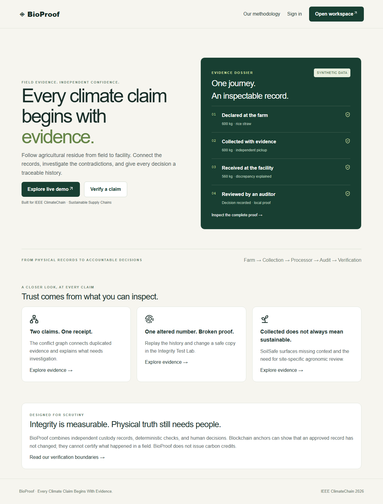
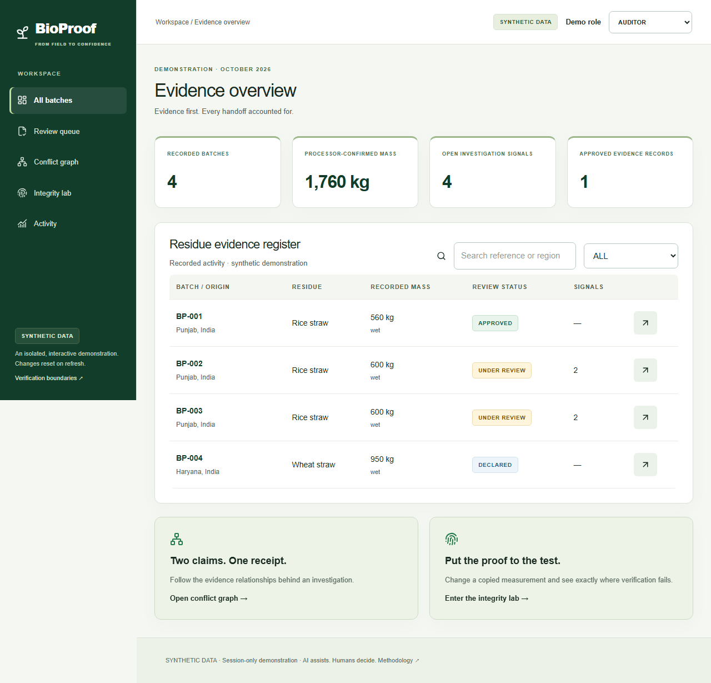
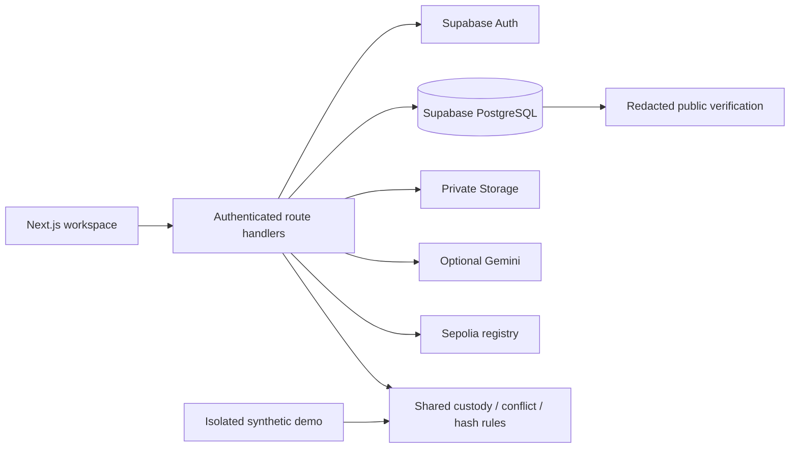

# BioProof

**Every Climate Claim Begins With Evidence.**

An agricultural-residue evidence and audit platform for IEEE ClimateChain 2026, Sustainable Supply Chains.



## Why evidence matters

A farmer declares 600 kg of straw. A collector records 600 kg. A processor receives 560 kg. Which records explain the difference, and has the receipt supported another claim? BioProof connects those records to independent decisions. It does not issue carbon credits or claim that a blockchain proves physical truth.

## Run locally

Node.js 24 and npm are recommended.

```sh
npm ci
npm run dev
```

Open **http://localhost:3000** and select **Explore live demo**. No credentials are needed. Switch between Farmer, Collector, Processor and Auditor in the isolated demo. Changes persist across demo navigation in React memory and reset on refresh. No browser storage is an operational database.

## Working modules

- Farmer plots, drafts and declarations; independent collection and processor intake.
- Role-checked transitions, immutable original declarations and appended correction requests.
- Private file uploads, actual-byte SHA-256 hashes and 60-second signed downloads.
- Facility-scoped receipt reuse, identical-file, plot/time overlap, chronology, missing-evidence and weight checks.
- Interactive conflict graph and accessible investigation list.
- Auditor clarification, resolution, approval/rejection and disputes.
- Canonical hash-chain replay, isolated tamper lab, redacted public verification and QR.
- SoilSafe advisory and documented agronomic review without a universal safe limit.
- Optional server-side Gemini extraction and Sepolia registry integration.
- Recorded-activity metrics without invented emissions conversions.

## Demo scenarios

| Route                | Demonstration                                                    |
| -------------------- | ---------------------------------------------------------------- |
| /demo/batches/BP-001 | 600 kg pickup, 560 kg intake, documented synthetic audit         |
| /demo/conflicts      | BP-002 and BP-003 share receipt WB-2002 and document bytes       |
| /demo/lab            | Change a copied quantity to 601; detect the first broken event   |
| /demo/batches/BP-004 | 950/1,000 kg proposed removal requests agronomic review          |
| /verify/BP-001       | Redacted record; local integrity separate from blockchain status |



## Stack and architecture

Next.js App Router, React, strict TypeScript, Tailwind/CSS, Lucide, Zod, Supabase Auth/PostgreSQL/private Storage, ethers, Solidity, Hardhat, Vitest and Playwright. PGlite is a test-only PostgreSQL engine, not a second production database.



See [architecture](docs/ARCHITECTURE.md), [data model](docs/DATA_MODEL.md), and [security](docs/SECURITY.md).

## Configure operational accounts

1. Copy `.env.example` to `.env.local`; never commit secrets.
2. Create a Supabase project. Apply `supabase/migrations/001_evidence.sql`, then `002_ai_limits.sql` through the SQL editor or linked Supabase migration CLI.
3. Set Supabase URL, public anon key and server-only service-role key. Restart Next.js.
4. Create confirmed users through Supabase administrator tools. The profile trigger assigns FARMER; clients cannot self-select privileged roles.
5. Assign separate COLLECTOR, PROCESSOR and AUDITOR profiles as a trusted administrator.
6. Sign in at /login, register a plot, create a batch, declare it, and continue with independent accounts.

Run `npm run check:supabase` after configuration. This read-only check validates the project URL, server table access, anonymous access denial, private bucket, RPC availability and saved batch hash chains. Use the project origin URL only, without `/rest/v1/`. It never prints keys or private record contents. See [live workflow steps](docs/LIVE_WORKFLOW.md) for the remaining account actions.

Administrator-only role assignment:

```sql
update public.profiles
set role = 'AUDITOR', full_name = 'Independent reviewer'
where id = 'replace-with-auth-user-uuid';
```

The migration creates a private evidence bucket. JPEG, PNG and PDF uploads are checked by size and signature, limited to 5 MB and 30 assets per batch. Hosting request limits can be lower; keep uploads below those limits or add direct signed uploads before increasing capacity.

## Environment

| Variable                                    | Purpose                                             |
| ------------------------------------------- | --------------------------------------------------- |
| NEXT_PUBLIC_SUPABASE_URL                    | Supabase project URL                                |
| NEXT_PUBLIC_SUPABASE_ANON_KEY               | Public project key; RLS denies private tables       |
| SUPABASE_SERVICE_ROLE_KEY                   | Server-only database/storage credential             |
| GEMINI_API_KEY                              | Optional server-only extraction credential          |
| GEMINI_MODEL                                | Configurable model, default gemini-2.5-flash        |
| SEPOLIA_RPC_URL                             | Optional Sepolia RPC                                |
| ANCHOR_PRIVATE_KEY                          | Server-only funded testnet signer                   |
| EVIDENCE_REGISTRY_ADDRESS                   | Deployed registry address                           |
| NEXT_PUBLIC_APP_URL                         | Canonical URL used by QR codes                      |
| NEXT_PUBLIC_WEIGHT_REVIEW_THRESHOLD_PERCENT | Review threshold, default 5; rebuild after changing |

AI suggestions require explicit review. Without a key, original inspection and manual structured entry still work. Confirmed fields append an event; they never silently overwrite custody measurements or approve claims. Attempts are limited to ten per actor/hour in PostgreSQL, with a daily global guard.

## Contract

```sh
npm run test:contract
# Configure .env.local with a Sepolia RPC and funded signer:
npm run deploy:contract
```

The deployment script refuses other networks and prints the actual address/transaction. Set the contract address and restart. As auditor, approve a real record and use Request / check anchor.

The registry commits to the approved event prefix, with an authorized immutable signer and monotonic version. Requests reserve each batch/root before broadcast. An uncertain submission without a saved transaction hash needs administrator reconciliation, not blind retries. Confirmation requires both a successful transaction and a matching registry read. Local demo hashes are never represented as confirmed transactions.

## Quality gate

```sh
npm run lint
npm run typecheck
npm run test
npm run test:contract
npm run build
npx playwright install chromium
npm run test:e2e
```

SQL tests use real PostgreSQL execution in PGlite with test Auth/Storage schema fixtures. They do not replace hosted Supabase integration testing. Playwright covers desktop/mobile and the complete custody-to-review demo. GitHub CI runs the same checks.

## Deployment preparation

Vercel configuration is included. Import the repository, set environment variables and NEXT_PUBLIC_APP_URL, apply Supabase migrations, provision accounts, then deploy and run a hosted smoke test. Without credentials the synthetic demo works and private APIs fail closed. The user requested local preparation and will configure external services later.

## Limits

- Integrity does not establish truthful physical observations. A database superuser can rewrite an unanchored history; external commitments improve detection.
- Receipt reuse can be legitimate; resolution requires documented human reasoning.
- Unknown mass bases produce uncertainty. SoilSafe is not professional agronomic certification.
- No satellite data, live field pilot, certified credit or automatic emissions estimate is invented.
- Public records exclude private identities, files and precise-coordinate fields. Full recomputation needs the authorized private export.
- The initial workspace fails closed above 1,000 records; indexed conflict queries and pagination are needed for scale.
- Perceptual image similarity is not implemented; duplicate files use exact bytes.
- Live Auth/Storage, AI and Sepolia require configuration and real smoke tests.

[Methodology](docs/METHODOLOGY.md) · [Demo script](docs/DEMO_SCRIPT.md) · [Submission draft](docs/HACKATHON_SUBMISSION.md) · [Release status](docs/RELEASE_STATUS.md)

## Attribution and roadmap

Biozer, Greentrace, INATrace, AgriLink, SoilStack, Guardian and BioLoopAI were inspected. No source code was copied. See [reference review](docs/REFERENCES.md).

Next: hosted acceptance testing, direct signed uploads, indexed conflict search, organization assignments, offline capture, managed signing and documented field pilots.
