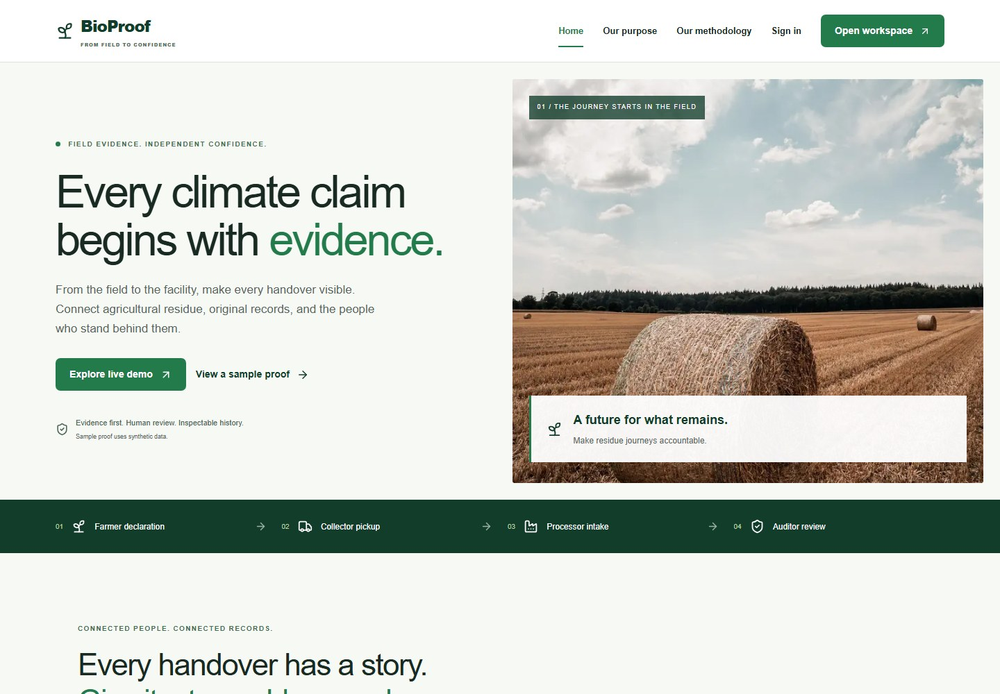
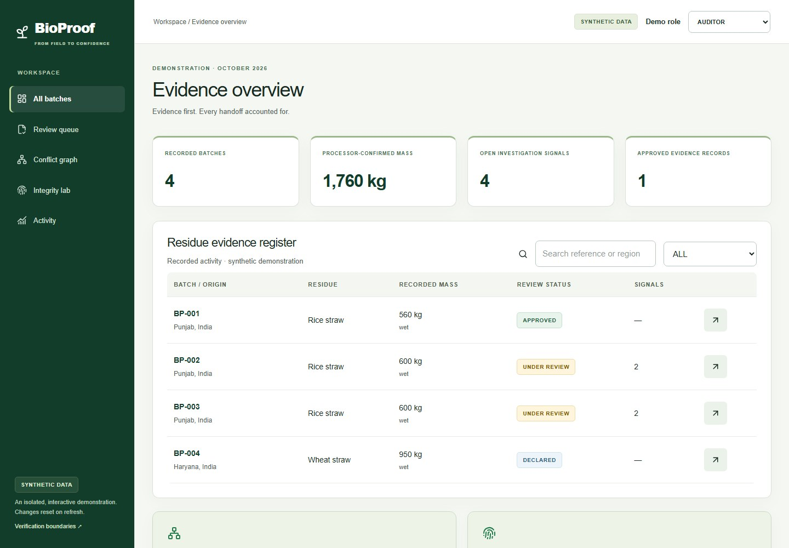
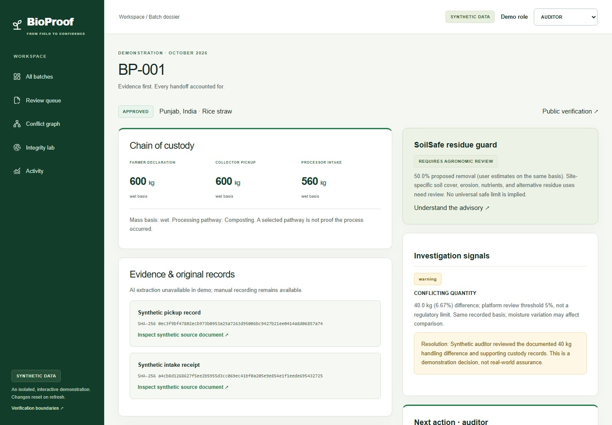
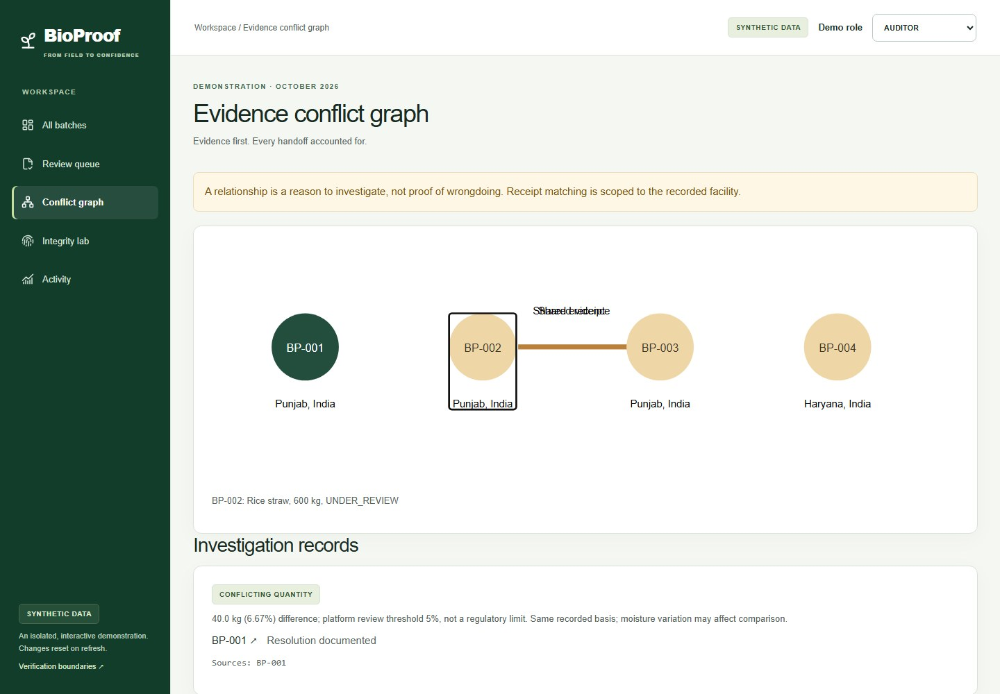
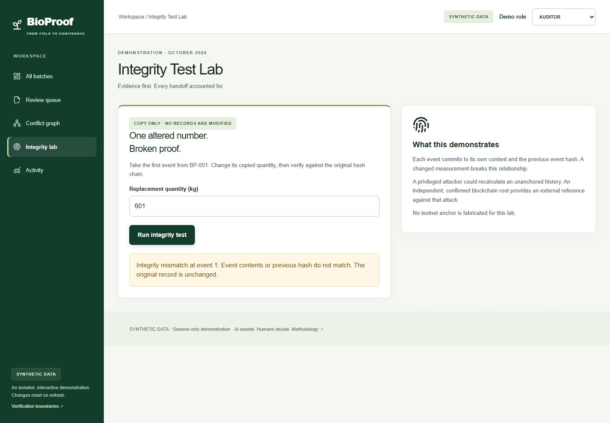
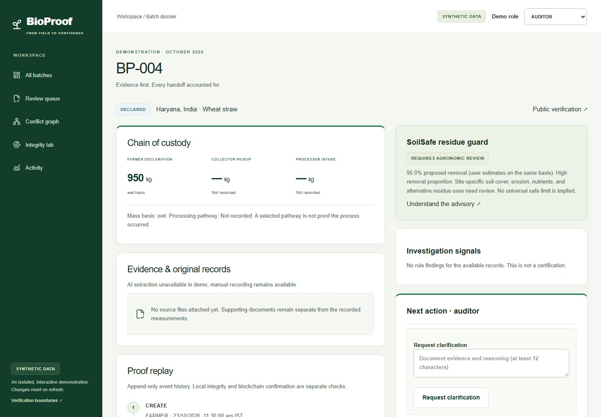
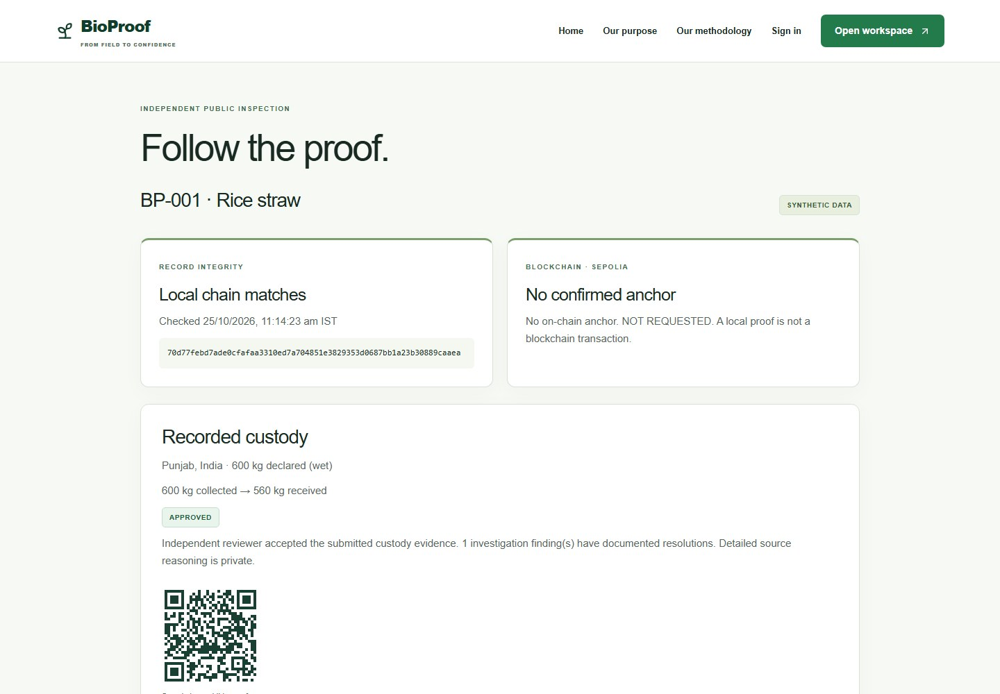
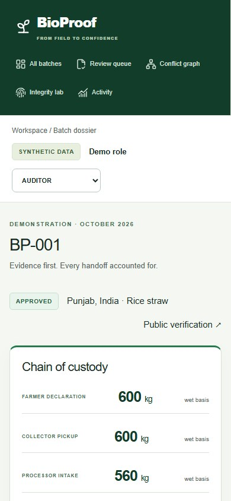
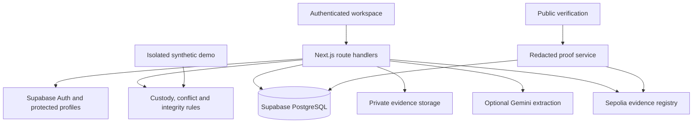

# StubbleTrail

**Follow agricultural residue from the field to the records behind the claim.**

StubbleTrail is an agricultural-residue traceability and review platform built by **Prince Pundir** for the **IEEE ClimateChain Hackathon — Sustainable Supply Chains** track. It connects farmer declarations, collection measurements, processor receipts and supporting documents in one inspectable history.

[Try the live application](https://stubbletrail.vercel.app/) · [Watch the demo](https://www.youtube.com/watch?v=spIsyBMHrfs) · [Explore a public proof](https://stubbletrail.vercel.app/verify/BP-001)

> The application interface and repository still use the earlier name **BioProof**. StubbleTrail is the submission name. The public demo uses clearly labeled synthetic records; it does not represent a field pilot or certified climate benefits.



## The problem

A collector records 600 kg of rice straw. The processor records 560 kg at intake. A receipt used for another batch appears again. Before anyone relies on the resulting sustainability claim, a reviewer needs to understand what happened, which documents support it and who made each decision.

StubbleTrail brings those records together. It flags discrepancies for investigation, preserves the original measurements and records the reviewer's reasoning. AI can help read documents, and a blockchain commitment can provide an external reference for the approved record. Neither replaces a truthful measurement or an independent review.

## Watch the project walkthrough

[](https://www.youtube.com/watch?v=spIsyBMHrfs)

**[Watch the updated demo →](https://www.youtube.com/watch?v=spIsyBMHrfs)**

The walkthrough covers the four participant roles, document review, cross-batch findings, SoilSafe, a tamper test, public verification and the Sepolia registry integration. The AI inspector preview is labeled separately from live extraction, and registry deployment is distinguished from anchoring a batch.

## How a batch moves through the system

| Participant        | What they record                                                                         | What happens next                                                             |
| ------------------ | ---------------------------------------------------------------------------------------- | ----------------------------------------------------------------------------- |
| **Farmer**         | A registered plot, crop residue, origin region, available quantity and measurement basis | Creates a draft and submits its declaration                                   |
| **Collector**      | Pickup quantity, basis, actual event time and a measurement explanation                  | Adds an independent collection record and supporting evidence                 |
| **Processor**      | Intake quantity, facility, receipt, event time and documented processing pathway         | Attaches intake evidence and requests audit review                            |
| **Auditor**        | Clarifications, finding resolutions, agronomic review and decision reasoning             | Approves or rejects the evidence; disputes remain part of the history         |
| **Public visitor** | No account required                                                                      | Inspects a redacted proof, event hashes and separately reported anchor status |

Operational permissions come from authenticated server-side profiles. Users cannot choose a privileged role in the login form. The role selector in `/demo` is part of an isolated practice environment.

## Screenshots

These screenshots were captured from the deployed public demo. The records and source documents shown are synthetic.

### Workspace and custody

The overview shows batch activity and review status. A dossier keeps the farmer declaration, collector pickup and processor intake alongside source files, investigation findings and recorded actions.

| Workspace overview                                                                                  | Batch dossier                                                                                       |
| --------------------------------------------------------------------------------------------------- | --------------------------------------------------------------------------------------------------- |
|  |  |

### Investigation and integrity

The conflict graph connects records that share a receipt or identical document bytes. The integrity lab changes a copy of an event and checks it against the original chain; it does not modify the saved record.

| Cross-batch investigation                                                                                       | Copy-only tamper test                                                                                                     |
| --------------------------------------------------------------------------------------------------------------- | ------------------------------------------------------------------------------------------------------------------------- |
|  |  |

### Soil review and public verification

SoilSafe asks for site-specific review of proposed residue removal. The public portal shows a redacted custody summary and distinguishes a matching local chain from a confirmed blockchain anchor.

| SoilSafe advisory                                                                                                   | Public proof                                                                                                                                        |
| ------------------------------------------------------------------------------------------------------------------- | --------------------------------------------------------------------------------------------------------------------------------------------------- |
|  |  |

<details>
<summary>View the mobile dossier</summary>

<br>


</details>

## What is implemented

### Records and independent review

- Plot registration, batch drafts, declarations, pickup and intake records.
- Role-checked transitions and appended correction requests that preserve original declarations.
- Auditor clarification, documented finding resolution, approval, rejection and disputes.
- Receipt reuse within a facility, identical-file hashes, plot/time overlap, chronology, missing evidence and quantity checks.
- A conflict graph with an accompanying investigation list.
- SoilSafe guidance and recorded agronomic review, without a universal safe removal threshold.

### Evidence and AI assistance

- Private JPEG, PNG and PDF uploads, checked by file signature and size.
- SHA-256 hashes calculated from actual file bytes and short-lived signed downloads.
- Optional Gemini extraction of structured document fields, with uploader authorization and editable suggestions.
- Explicit confirmation into the audit history. Confirmed fields do not silently replace custody measurements or approve a batch.
- Database-enforced extraction limits: ten attempts per actor per hour and a shared rolling budget of 100 attempts per 24 hours.

### Integrity and public inspection

- Canonically serialized, linked SHA-256 events and an isolated tamper lab.
- Transactional, version-checked updates with idempotency protection.
- Redacted public verification and a QR link to the public record.
- Optional Sepolia anchoring of the approved event prefix for real, approved batches.
- Separate pending, failed, unavailable and confirmed anchor outcomes. Confirmation requires a successful transaction and a matching registry proof.

## Try the demo without an account

Open **[stubbletrail.vercel.app/demo](https://stubbletrail.vercel.app/demo)**. Switch among the four demo roles to explore their interfaces. Demo changes stay in React memory across navigation and reset on refresh; they never write to the operational database.

| Scenario                                                                           | What to inspect                                                              |
| ---------------------------------------------------------------------------------- | ---------------------------------------------------------------------------- |
| [BP-001: custody discrepancy](https://stubbletrail.vercel.app/demo/batches/BP-001) | 600 kg collected, 560 kg received and a documented synthetic audit           |
| [Conflict graph](https://stubbletrail.vercel.app/demo/conflicts)                   | BP-002 and BP-003 share receipt `WB-2002` and document bytes                 |
| [Integrity lab](https://stubbletrail.vercel.app/demo/lab)                          | Change the copied quantity to `601` and run the integrity test               |
| [BP-004: SoilSafe](https://stubbletrail.vercel.app/demo/batches/BP-004)            | Proposed removal of 950 kg from 1,000 kg of generated residue                |
| [Public proof](https://stubbletrail.vercel.app/verify/BP-001)                      | Redacted custody, local integrity and the sample's unconfirmed anchor status |

Live AI extraction and blockchain transactions require configured operational accounts. The synthetic demo does not fabricate either.

## Architecture

The application uses **Next.js App Router, React and TypeScript**. Supabase provides authentication, PostgreSQL and private object storage. Gemini is optional for extraction; ethers and a Solidity registry support Sepolia commitments. Zod validates incoming data. Vitest, PGlite, Playwright and local contract checks cover the main workflows.



Private route handlers validate the authenticated user and derive the role from a protected profile. A database transaction checks the expected version, preserves the existing event prefix, appends the next event and updates the relational projections atomically. Files remain in private storage; the public serializer excludes private identities, source files and precise-coordinate fields.

See the [architecture notes](docs/ARCHITECTURE.md), [data model](docs/DATA_MODEL.md) and [security model](docs/SECURITY.md) for implementation details.

## Run locally

Use **Node.js 24** and npm.

```sh
git clone https://github.com/PrincePundir123/bioproof-climatechain.git
cd bioproof-climatechain
npm ci
npm run dev
```

Open **http://localhost:3000**. The synthetic demo works without service credentials. Operational login, private evidence, AI and anchoring need the configuration below.

### Configure Supabase

1. Copy `.env.example` to `.env.local` and enter your Supabase project URL, public anon key and server-only service-role key.
2. Apply these migrations in order using Supabase SQL Editor or the linked migration CLI:
   - [`001_evidence.sql`](supabase/migrations/001_evidence.sql): core records, permissions, private storage and transactional writes.
   - [`002_ai_limits.sql`](supabase/migrations/002_ai_limits.sql): extraction attempt tracking.
   - [`003_atomic_ai_budget.sql`](supabase/migrations/003_atomic_ai_budget.sql): atomic hourly and shared rolling AI budgets.
3. Create confirmed users through trusted Supabase administrator tools. The profile trigger assigns `FARMER` by default.
4. Assign separate `COLLECTOR`, `PROCESSOR` and `AUDITOR` profiles as an administrator. Client requests cannot self-assign these roles.
5. Restart the application and run `npm run check:supabase`.
6. Sign in at `/login` and follow the [operational workflow](docs/LIVE_WORKFLOW.md).

The read-only configuration check validates table access, anonymous access denial, the private bucket, required RPCs and saved batch hash chains. It does not print credentials or private record contents. Use the Supabase project origin, without `/rest/v1/`.

### Environment variables

| Variable                                      | Purpose                                               |
| --------------------------------------------- | ----------------------------------------------------- |
| `NEXT_PUBLIC_SUPABASE_URL`                    | Supabase project origin                               |
| `NEXT_PUBLIC_SUPABASE_ANON_KEY`               | Public project key; private tables remain protected   |
| `SUPABASE_SERVICE_ROLE_KEY`                   | Server-only database and storage credential           |
| `NEXT_PUBLIC_APP_URL`                         | Canonical application origin used in public QR links  |
| `GEMINI_API_KEY`                              | Optional server-only extraction credential            |
| `GEMINI_MODEL`                                | Configurable model; default `gemini-3.1-flash-lite`   |
| `SEPOLIA_RPC_URL`                             | Optional Ethereum Sepolia RPC endpoint                |
| `ANCHOR_PRIVATE_KEY`                          | Server-only dedicated testnet signer                  |
| `EVIDENCE_REGISTRY_ADDRESS`                   | Deployed evidence registry contract                   |
| `REGISTRY_DEPLOYMENT_TX`                      | Deployment transaction saved by the deployment script |
| `NEXT_PUBLIC_WEIGHT_REVIEW_THRESHOLD_PERCENT` | Quantity review threshold; defaults to `5`            |

Keep `.env.local` out of version control. Only variables with the `NEXT_PUBLIC_` prefix are intended for the browser. Rebuild after changing public configuration.

### Optional Gemini and Sepolia setup

```sh
npm run setup:optional
# Add the Gemini key locally and fund the dedicated signer with Sepolia test ETH.
npm run check:optional
npm run test:contract
npm run deploy:contract
```

The setup script prepares missing local settings and a dedicated testnet signer. The deployment script checks the network, funds and signing authority, then saves the registry address and deployment transaction locally. Restart the application after deployment.

An auditor can request an anchor for an approved, nonsynthetic batch. An uncertain broadcast requires reconciliation rather than blind retries. The contract commits to the approved event prefix; a later dispute remains visible even when that earlier commitment is valid. See [optional feature setup](docs/OPTIONAL_FEATURES.md).

## Validation

The latest local unit, API and database test run passed **93 tests**. The repository also includes desktop and mobile browser workflows and local contract checks. The [CI workflow](.github/workflows/ci.yml) runs lint, type checking, tests, contract checks, a production build and Playwright; clean installs are checked with npm 10 and npm 11.

```sh
npm run lint
npm run typecheck
npm test
npm run test:contract
npm run build
npx playwright install chromium
npm run test:e2e
```

For a focused end-to-end batch check:

```sh
npm run test:batch
npm run test:batch:browser
```

The complete-batch tests exercise declaration, pickup, intake, evidence, review and public proof. They also cover extraction confirmation and anchor status handling. SQL tests execute PostgreSQL behavior in PGlite with test Auth and Storage fixtures. External responses in these tests are controlled; they do not substitute for a hosted test with real accounts and configured services.

## Deploy on Vercel

1. Import this repository and use the included Vercel configuration.
2. Add the environment variables for the intended environment. Keep server credentials private.
3. Set `NEXT_PUBLIC_APP_URL` to the deployed origin, such as `https://stubbletrail.vercel.app`.
4. Configure the matching Supabase authentication URLs, apply all migrations and provision the operational accounts.
5. Deploy or redeploy after configuration changes.
6. Check login, one complete batch, evidence access, public QR links and any optional integrations on the hosted application.

The application accepts JPEG, PNG and PDF evidence up to 5 MB, with a 30-asset limit per batch. Hosting request limits may be lower; use smaller files within the host's limits. Direct signed uploads are a planned improvement.

## Scope and next steps

StubbleTrail is a working hackathon prototype. Hashes show whether records match an expected history; they do not prove that a delivery happened. A privileged database administrator could rewrite an unanchored chain. An external commitment provides a reference against that risk, rather than a guarantee of physical truth.

Receipt reuse may be legitimate and needs documented reasoning. Duplicate-file checks compare exact bytes, not perceptual image similarity. SoilSafe is advisory, and recorded quantities are not carbon credits or certified emissions reductions.

The initial workspace fails closed above 1,000 records to avoid silently missing conflicts. The next engineering work is indexed conflict search, pagination, organization-scoped access, direct signed uploads and managed signing. The next validation step is hosted acceptance testing followed by a documented field pilot with cooperatives, aggregators and independent reviewers.

## Further reading

- [Methodology and limits](docs/METHODOLOGY.md)
- [Architecture](docs/ARCHITECTURE.md) and [data model](docs/DATA_MODEL.md)
- [Security](docs/SECURITY.md) and [operational workflow](docs/LIVE_WORKFLOW.md)
- [Optional integrations](docs/OPTIONAL_FEATURES.md)
- [Demo guide](docs/DEMO_SCRIPT.md) and [narration script](docs/VIDEO_NARRATION.md)
- [Photo credits](docs/IMAGE_CREDITS.md) and [reference review](docs/REFERENCES.md)

The homepage photographs illustrate agricultural contexts. They are not batch evidence. Photograph sources and credits are documented separately.
