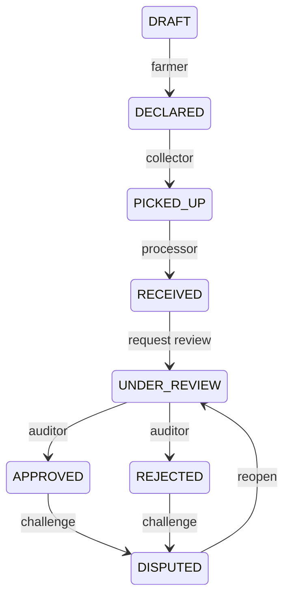

# Data model

| Table              | Responsibility                                              |
| ------------------ | ----------------------------------------------------------- |
| profiles           | Auth identity, administrator-assigned role                  |
| farm_plots         | Farmer-owned area/crop/region; optional private coordinates |
| residue_batches    | Current aggregate, declaration, state, optimistic version   |
| collection_events  | One independent pickup per source batch                     |
| processor_receipts | One intake per batch, facility-scoped receipt matching      |
| evidence_assets    | Private path, byte hash, MIME, size and uploader            |
| audit_events       | Immutable canonical events and per-batch sequence           |
| conflict_findings  | Deterministic findings and documented resolutions           |
| audit_decisions    | Immutable independent decisions                             |
| disputes           | Challenge records; disposition derived from later events    |
| ai_extractions     | Provider/model/suggestions; confirmations are audit events  |
| ai_usage           | Atomic hourly attempt counters                              |
| proof_anchors      | Unique batch/root reservation, transaction and status       |
| request_keys       | Idempotency keys scoped by actor/batch                      |

Blockchain state is separate: NOT_REQUESTED, PENDING, CONFIRMED or FAILED. A disputed batch can retain an authentic earlier anchor.

Correction requests append explanations, never rewrite original declarations or custody measurements. Material changes require a separately documented claim/review. Batch splitting/merging is not implemented.

Private tables enable RLS and deny browser mutation. Only the caller's profile is directly readable. Server routes use the protected service credential and enforce domain authorization. History triggers reject normal update/deletion; a superuser disabling protections is outside this guarantee.
